

## Non è la solita Napoli da cartolina

Accìrete non racconta favolette: racconta, attraverso la saggezza di un popolo, forza, rabbia e amore vero. Quello che nasce dalla fatica e diventa orgoglio.

Vuole raccontare la vera napoletanità, quella che resiste, che ride amaro ma non si piega, che non ha bisogno di maschere o stereotipi per farsi sentire. Qui si parla di chi ha fatto della dignità e dell’ironia la sua arma più potente.

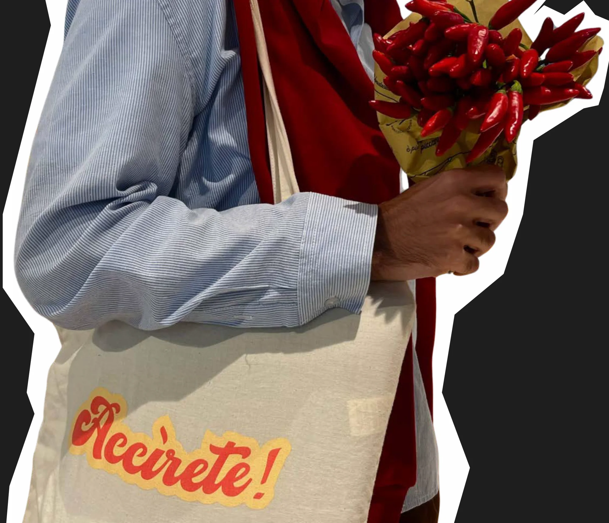

## Saggezza dal passato, visual moderni

Ogni design nasce da un detto napoletano, reinterpretato graficamente in chiave contemporanea. A ogni detto il suo carattere: corsivo, bastone, macchina da scrivere.

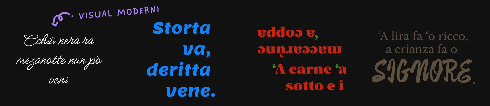

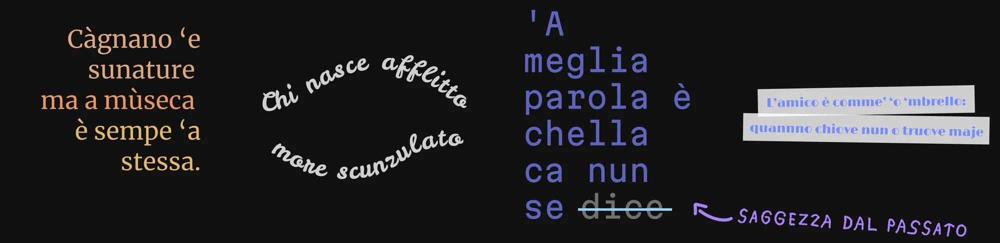

## Ogni detto, un manifesto

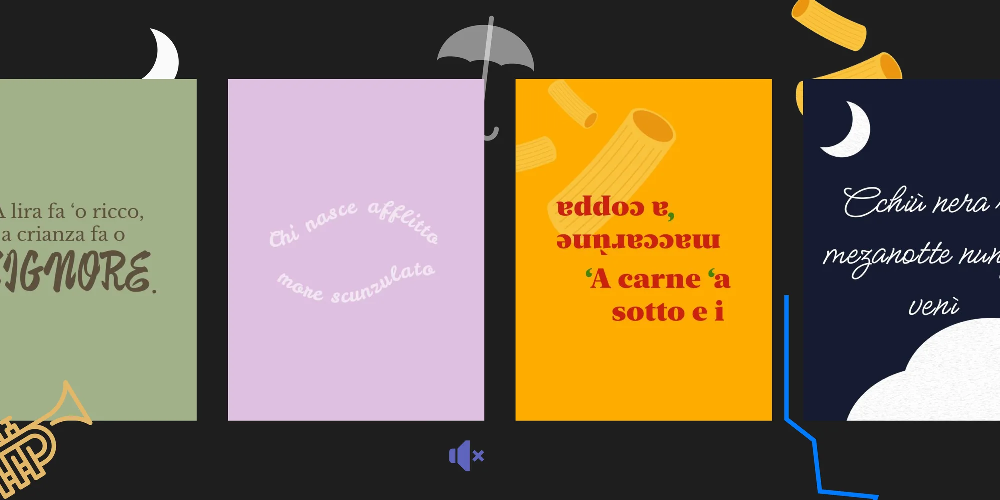

Ogni grafica è pensata per vivere su diversi supporti: tote bag, poster, sfondi.

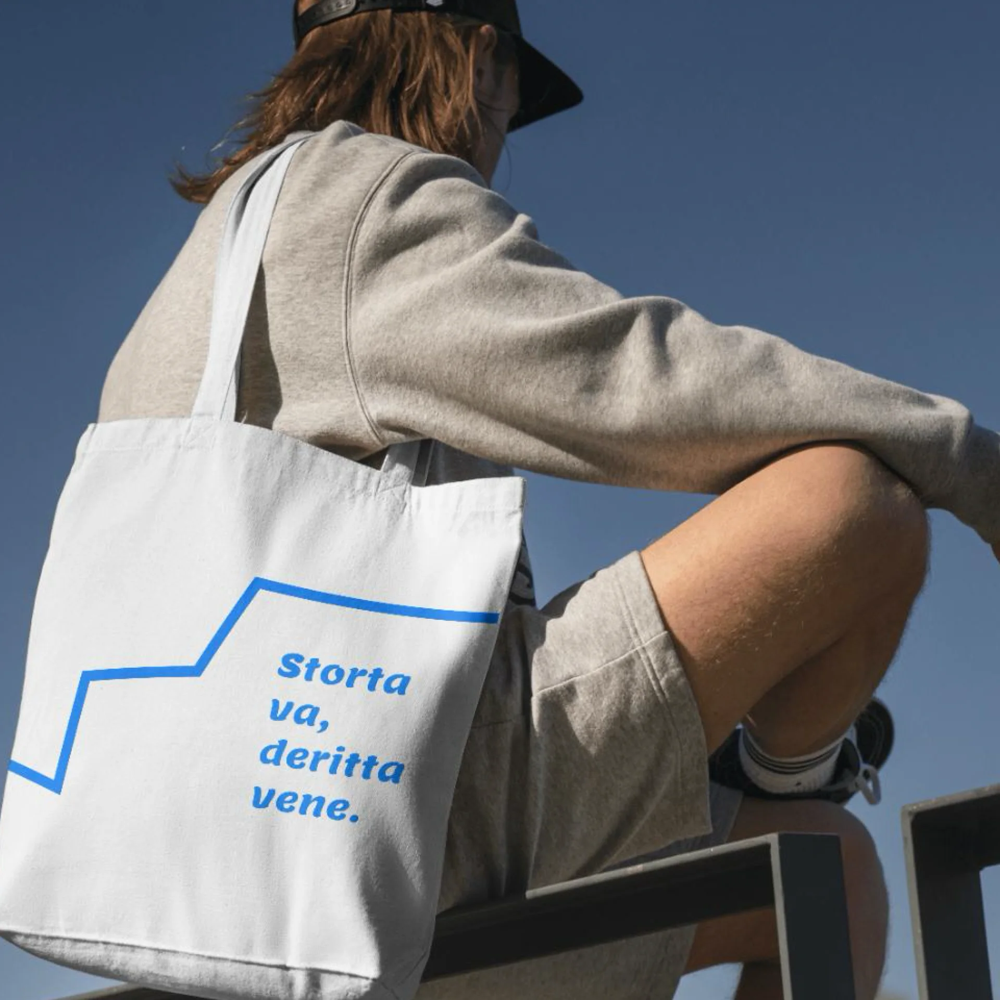
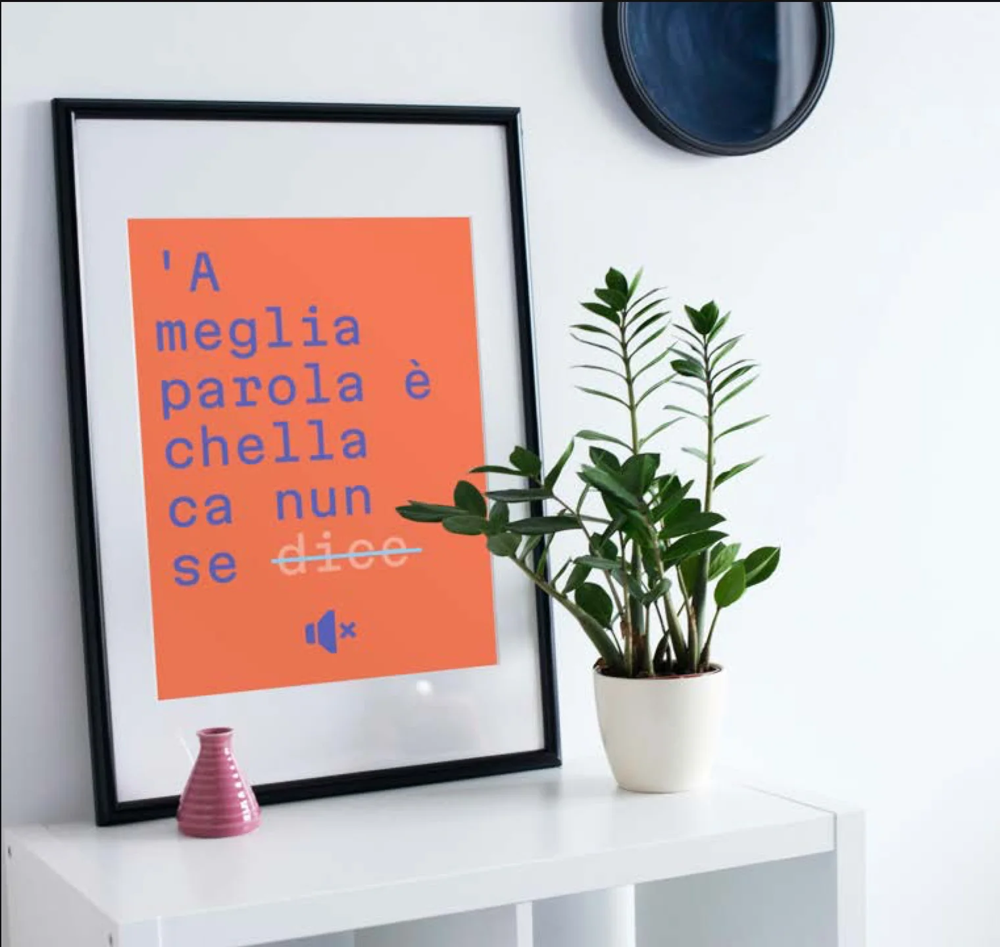

## Gli sfondi, con la traduzione

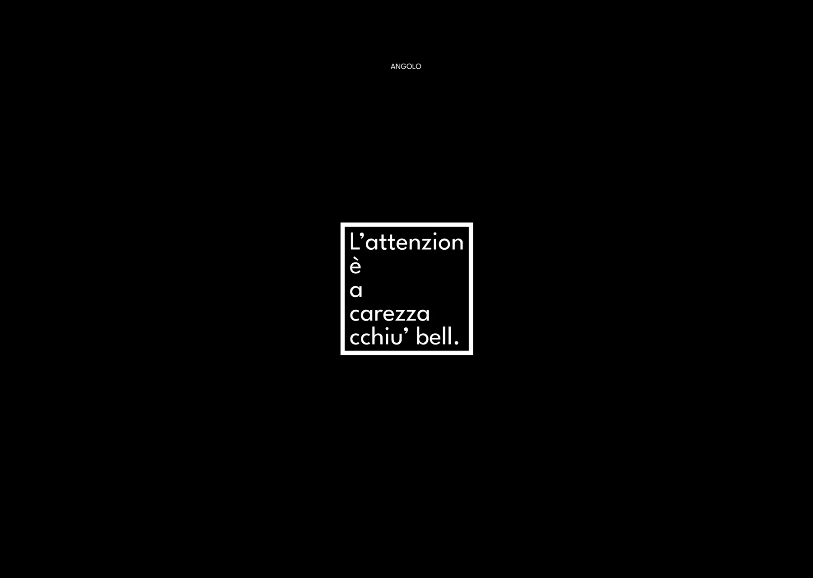

**L’attenzion è a carezza cchiù bell.**

L’attenzione è la carezza più bella.

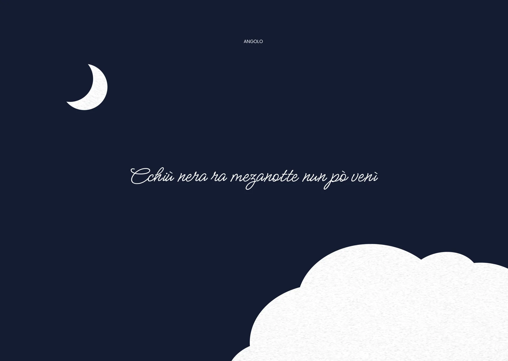

**Cchiù nera ra mezanotte nun pò venì.**

Più nera della mezzanotte non può venire: peggio di così non può andare.

**Càgnano ’e sunature ma a mùseca è sempe ’a stessa.**

Cambiano i suonatori, ma la musica è sempre la stessa.

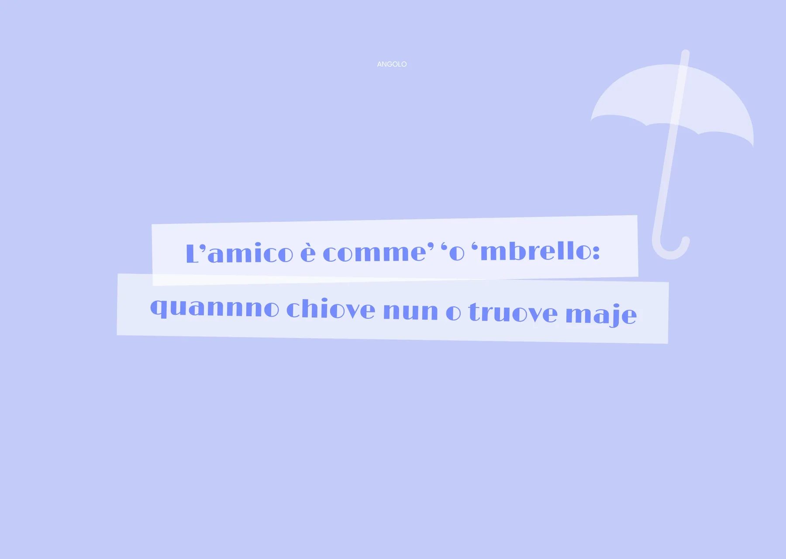

**L’amico è comme ’o ’mbrello: quanno chiove nun o truove maje.**

L’amico è come l’ombrello: quando piove non lo trovi mai.

**’A lira fa ’o ricco, a crianza fa o signore.**

I soldi fanno il ricco, l’educazione fa il signore.

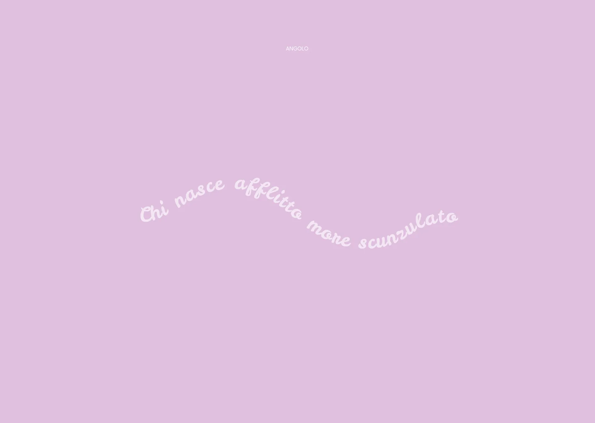

**Chi nasce afflitto more scunzulato.**

Chi nasce afflitto muore sconsolato.

**Storta va, deritta vene.**

Parte storta, arriva dritta: quello che comincia male può finire bene.

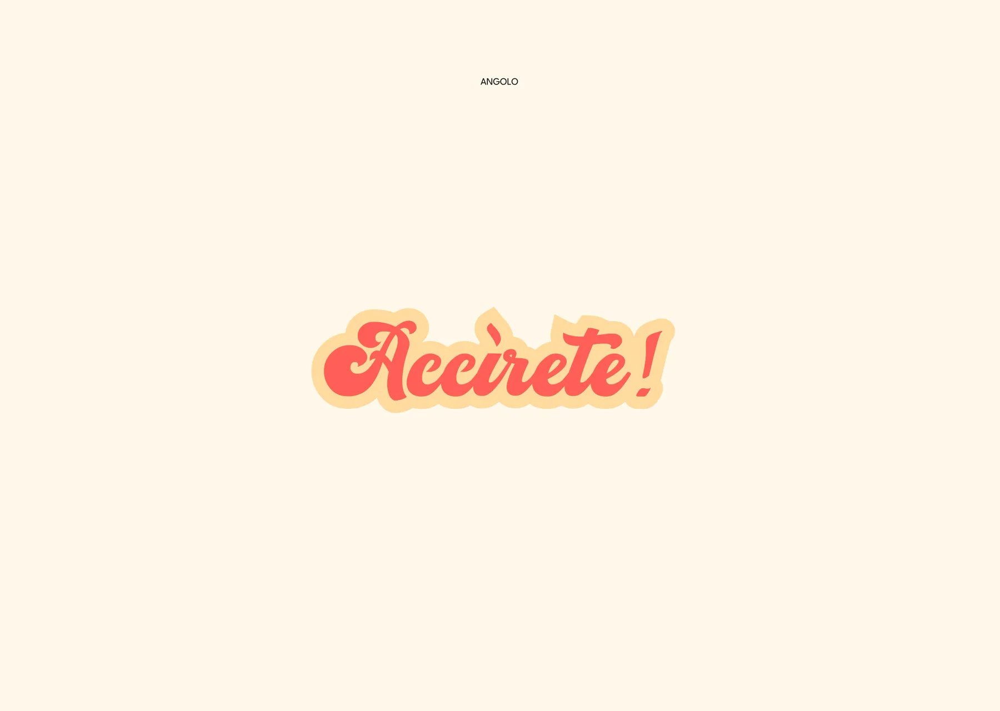

**Accìrete!**

Non è un consiglio, è un’esortazione.

## Se non siete pronti… accìriteve

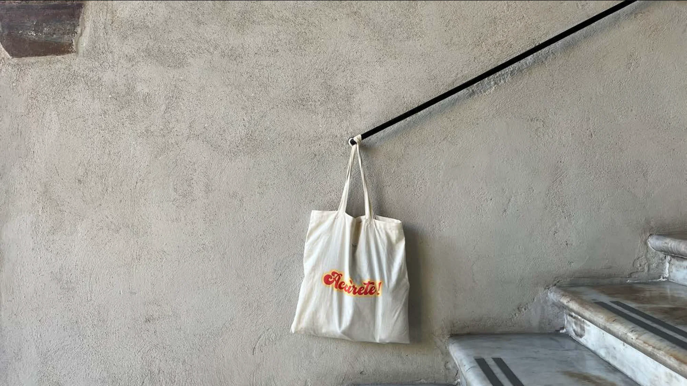
