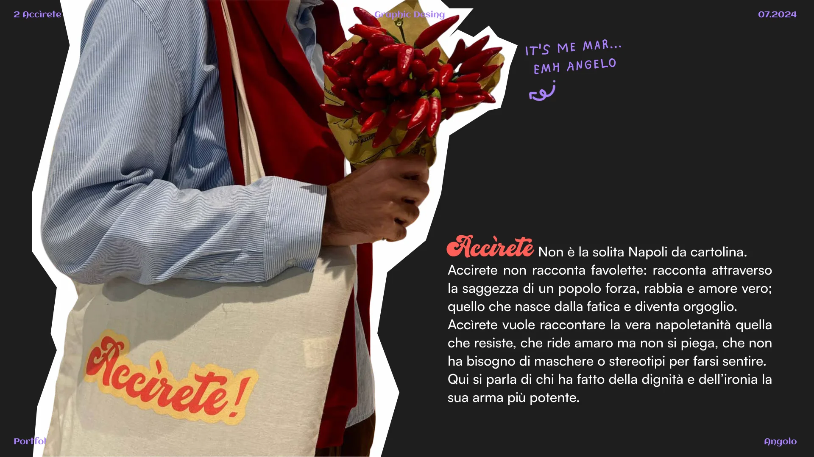
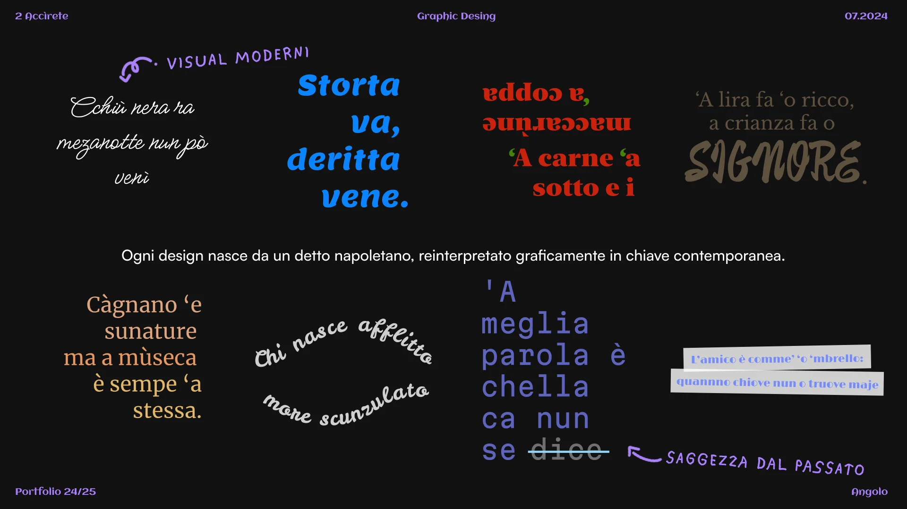
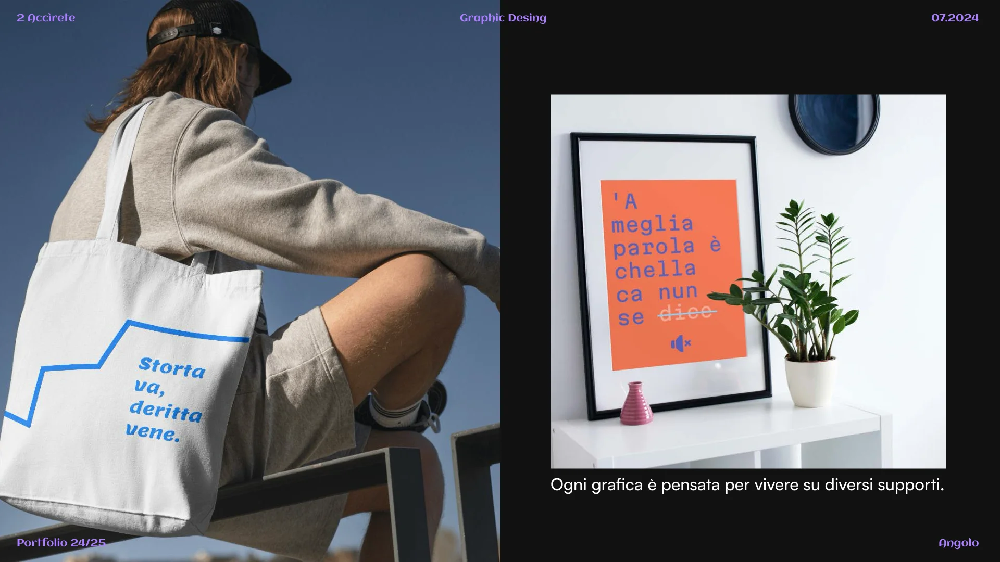
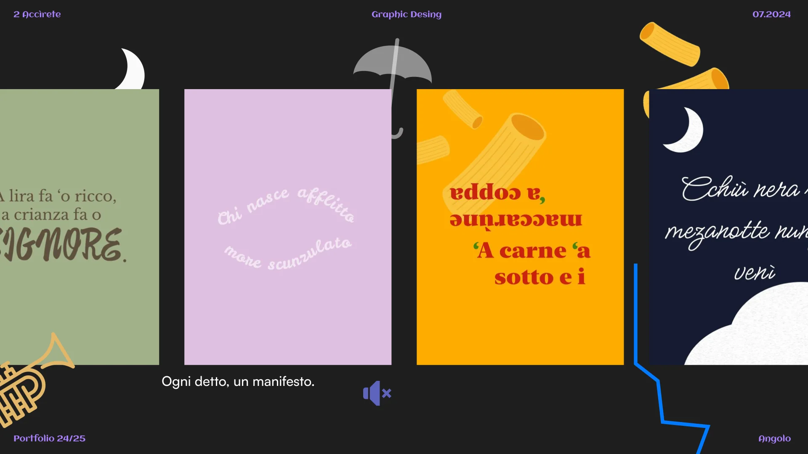
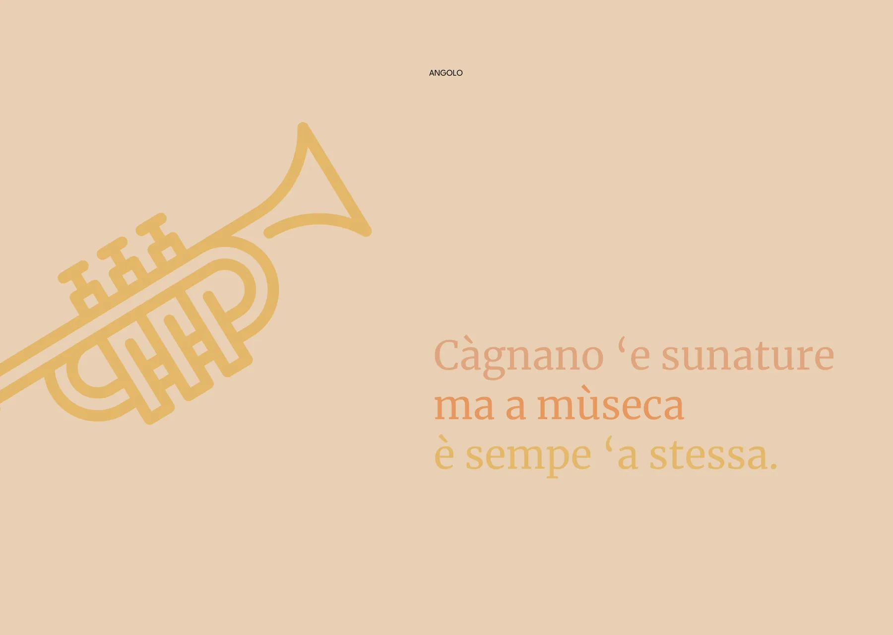
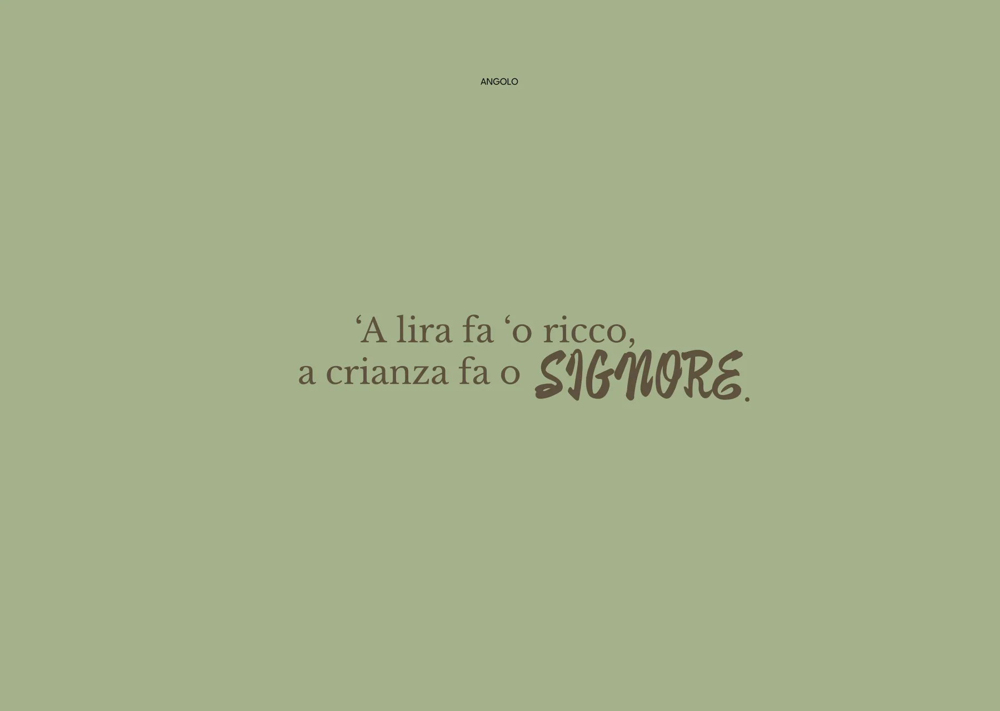
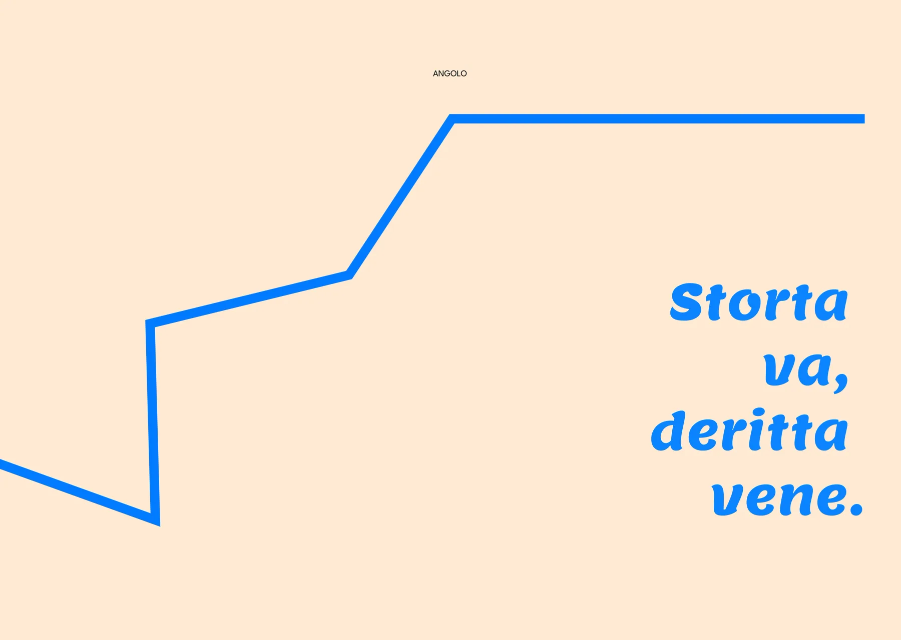
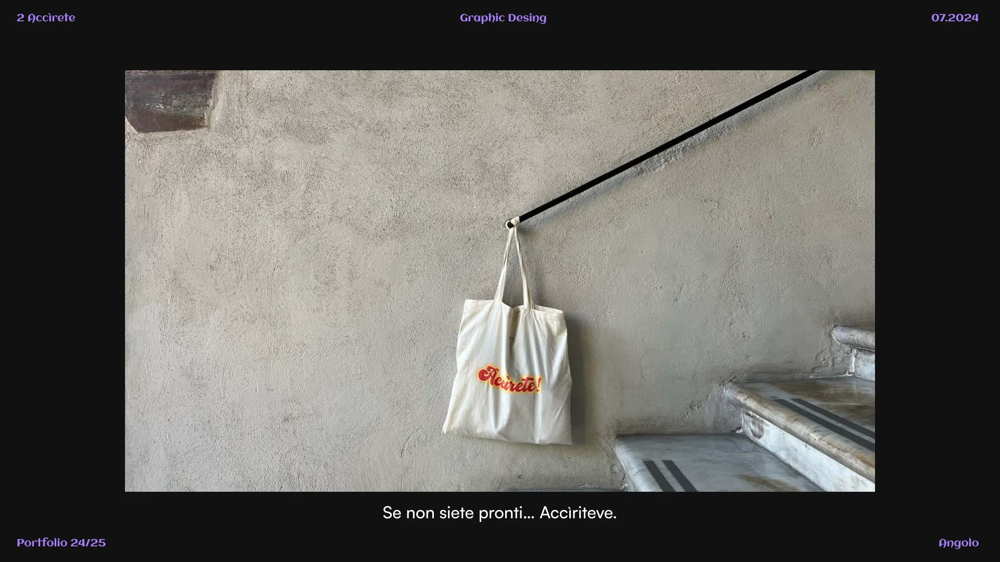

Accìrete non è la solita Napoli da cartolina. Non racconta favolette: racconta, attraverso la saggezza di un popolo, forza, rabbia e amore vero; quello che nasce dalla fatica e diventa orgoglio.

Vuole raccontare la vera napoletanità, quella che resiste, che ride amaro ma non si piega, che non ha bisogno di maschere o stereotipi per farsi sentire. Qui si parla di chi ha fatto della dignità e dell’ironia la sua arma più potente.

## Saggezza dal passato, visual moderni

Ogni design nasce da un detto napoletano, reinterpretato graficamente in chiave contemporanea.

## Ogni detto, un manifesto

Ogni grafica è pensata per vivere su diversi supporti: tote bag, poster, sfondi.

## Gli sfondi

Se non siete pronti… accìriteve.

