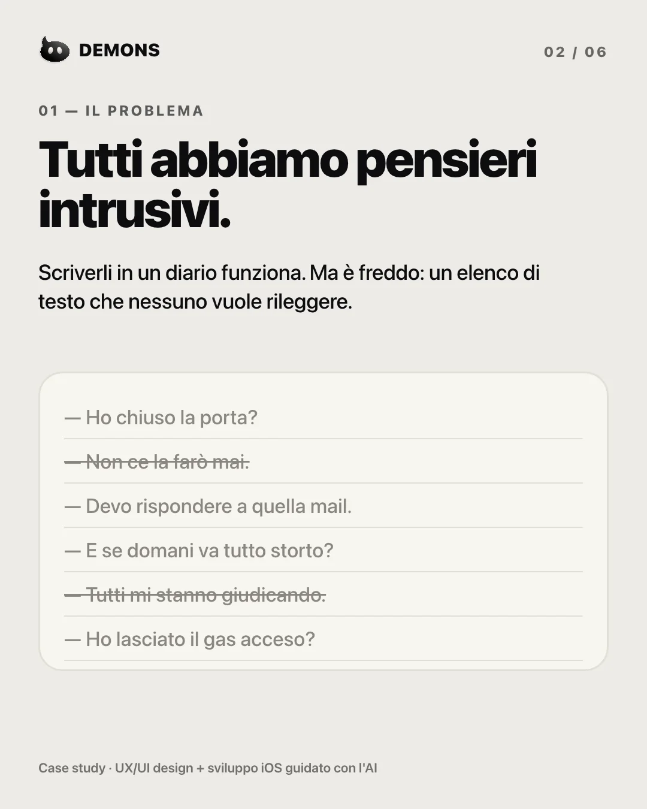
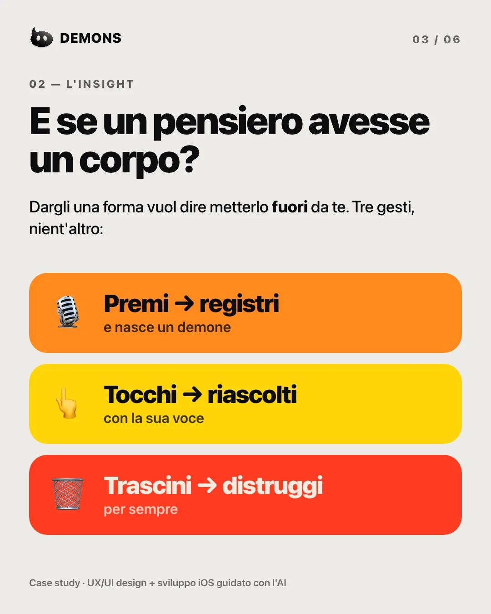
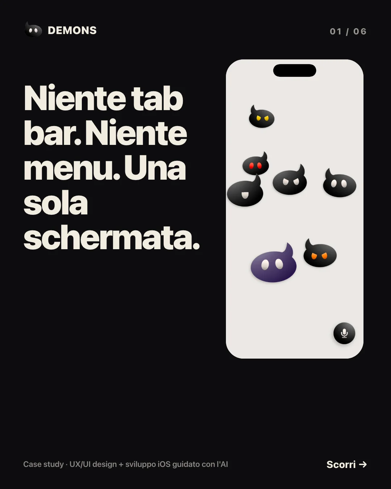
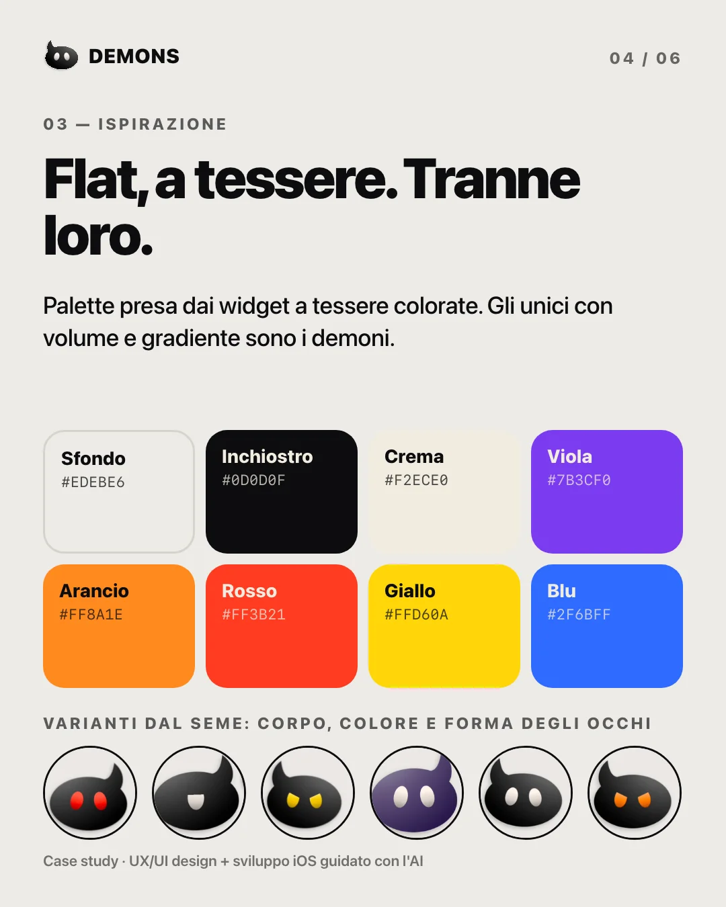
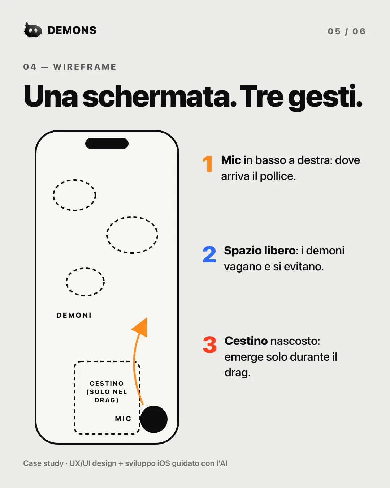
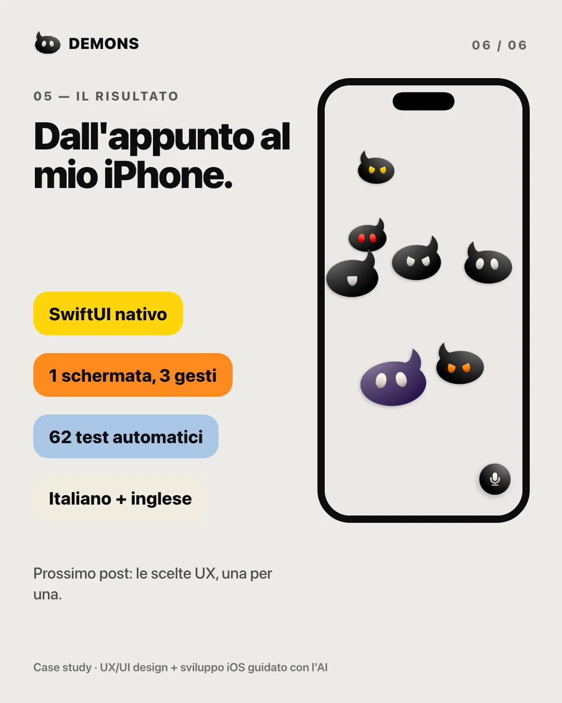
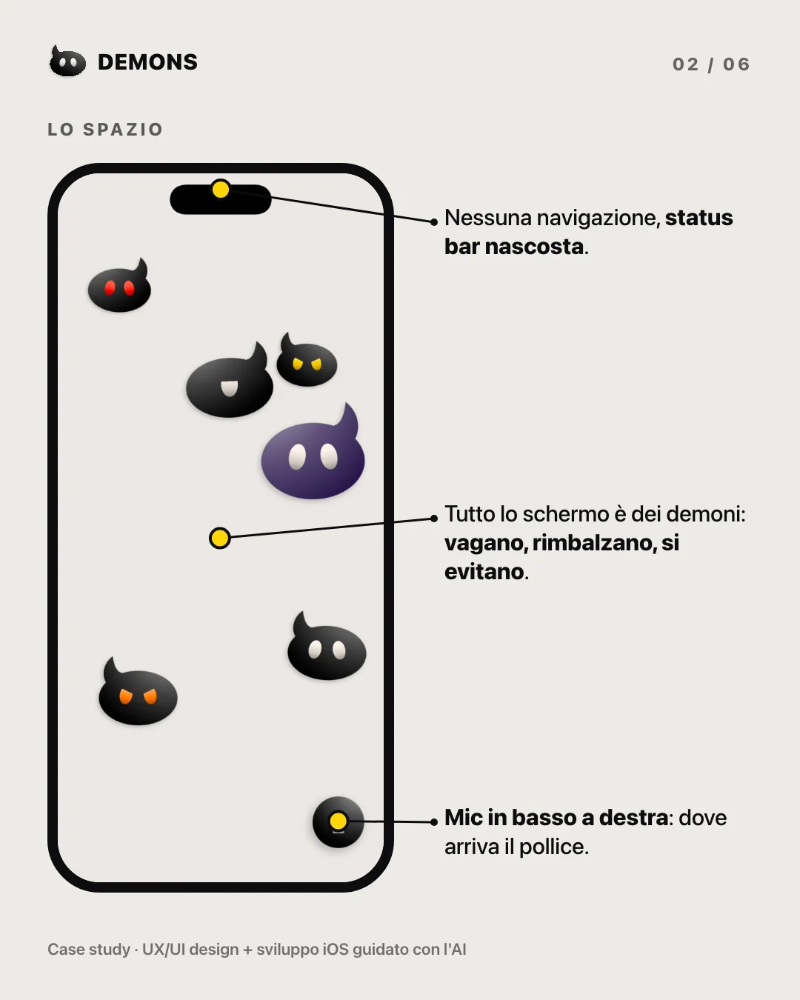

Tutti abbiamo pensieri intrusivi. Scriverli in un diario funziona, ma è freddo: un elenco di testo che nessuno vuole rileggere. E se un pensiero avesse un corpo?

## Una schermata, tre gesti

Premi il microfono e registri: nasce un demone. Lo tocchi e riascolti la nota con la sua voce. Lo trascini nel secchio e sparisce per sempre, con un Wilhelm Scream. Niente tab bar, niente menu.

## Flat, a tessere. Tranne loro

La palette viene dai widget a tessere colorate. Gli unici con volume e gradiente sono i demoni: corpo, colore, occhi e voce nascono da un seme, così ognuno è diverso.

## Dall’appunto al mio iPhone

Disegnato in Figma e costruito con Claude Code in SwiftUI nativo: una schermata, tre gesti, 62 test automatici, italiano e inglese. Se scuoti il telefono i demoni vengono sballottati e qualcuno resta confuso, con gli occhi a spirale.

