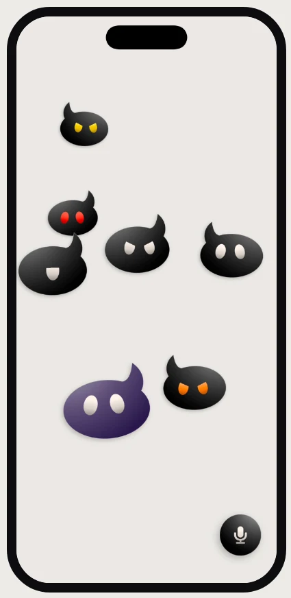
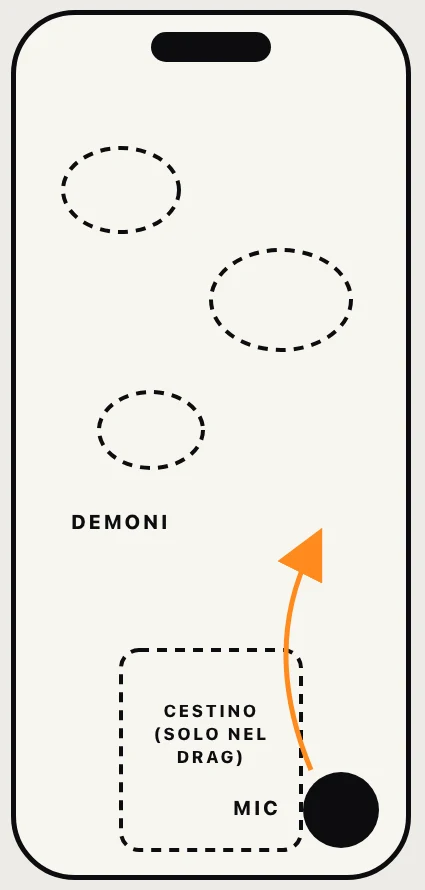
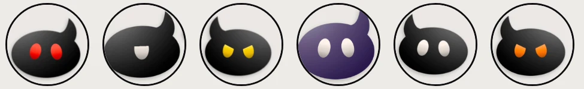

Tutti abbiamo pensieri intrusivi. Scriverli in un diario funziona, ma è freddo: un elenco di testo che nessuno vuole rileggere. E se un pensiero avesse un corpo? Dargli una forma vuol dire metterlo fuori da te.

## Una schermata, tre gesti

Niente tab bar, niente menu. Tutto lo schermo è dei demoni: vagano, rimbalzano, si evitano.

- **Premi il microfono** e registri: nasce un demone.
- **Lo tocchi** e riascolti la nota, con la sua voce.
- **Lo trascini nel secchio** e sparisce per sempre, con un Wilhelm Scream.

## Prima, su carta

Il microfono sta in basso a destra, dove arriva il pollice. Il cestino è nascosto: emerge solo mentre trascini un demone. Il resto è spazio libero.

## Flat, a tessere. Tranne loro

La palette viene dai widget a tessere colorate. Gli unici con volume e gradiente sono i demoni.

<ul class="swatches">
<li style="--c:#EDEBE6">Sfondo#EDEBE6</li>
<li style="--c:#0D0D0F;--t:#fff">Inchiostro#0D0D0F</li>
<li style="--c:#F2ECE0">Crema#F2ECE0</li>
<li style="--c:#7B3CF0;--t:#fff">Viola#7B3CF0</li>
<li style="--c:#FF8A1E">Arancio#FF8A1E</li>
<li style="--c:#FF3B21">Rosso#FF3B21</li>
<li style="--c:#FFD60A">Giallo#FFD60A</li>
<li style="--c:#2F6BFF;--t:#fff">Blu#2F6BFF</li>
</ul>

Corpo, colore, forma degli occhi e voce nascono da un seme: ogni demone è diverso dagli altri, e resta sempre lo stesso.

## Dall’appunto al mio iPhone

Disegnato in Figma e costruito con Claude Code:

- **SwiftUI nativo**, una schermata sola.
- **62 test automatici** su audio, fisica, vibrazione e scossoni.
- **Italiano e inglese.**
- Se scuoti il telefono i demoni vengono sballottati, e qualcuno resta confuso con gli occhi a spirale.
