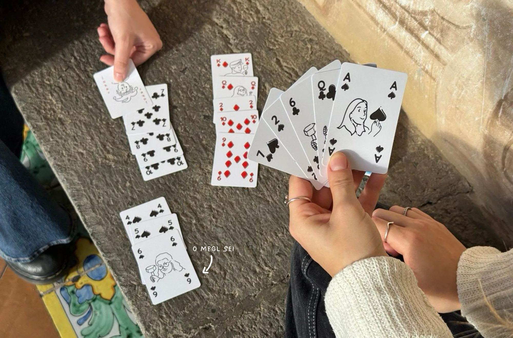
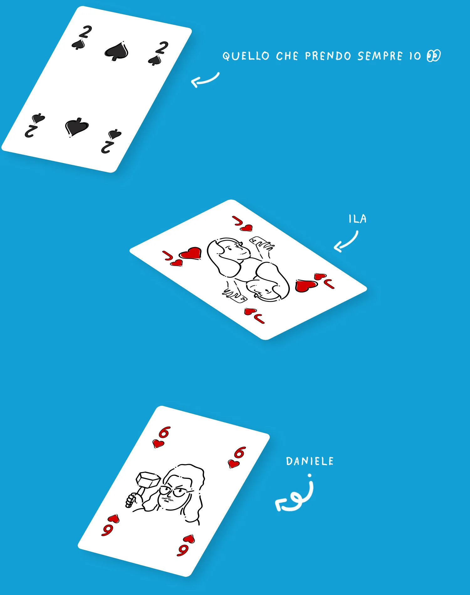
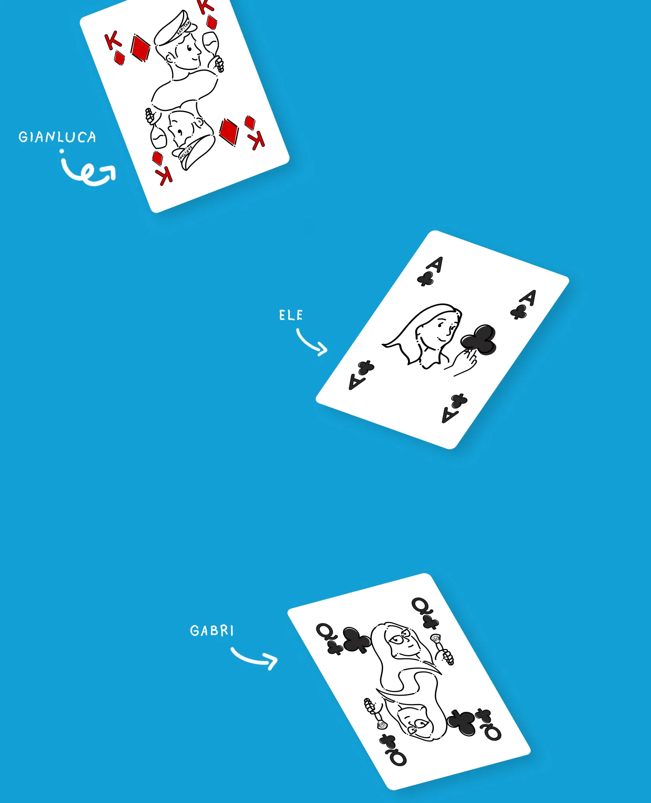
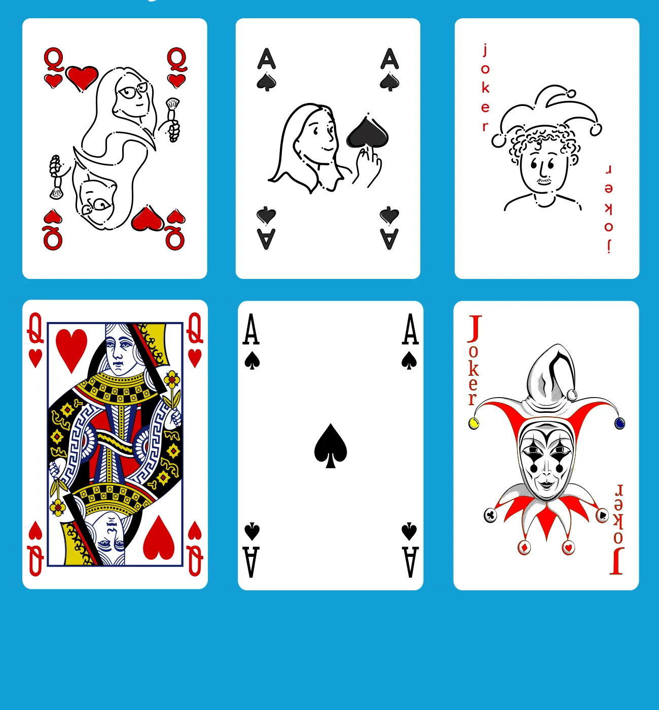
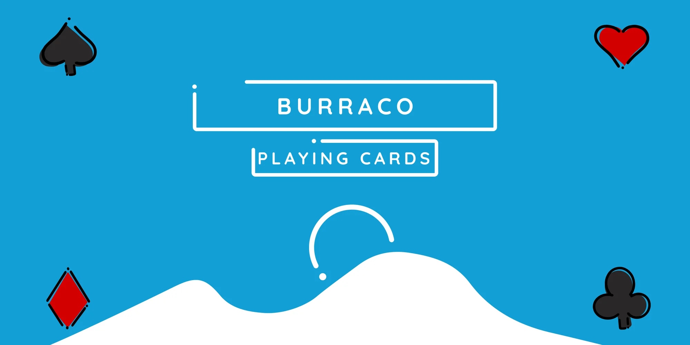
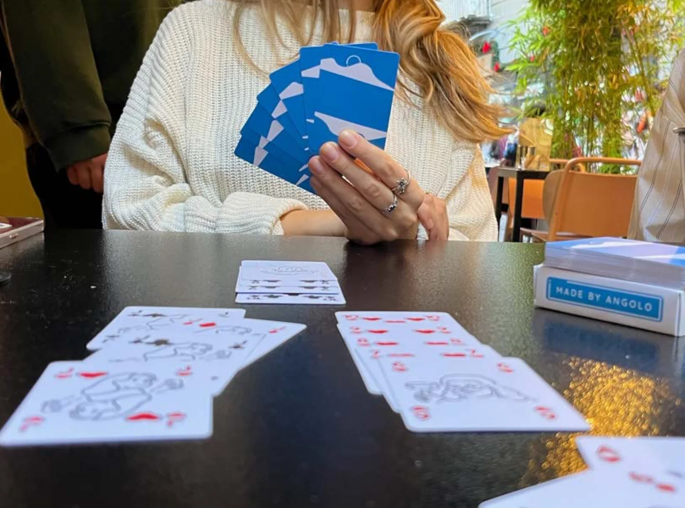

## Tutto nasce da una partita a burraco

Una di quelle serate dove la competizione lascia spazio alle risate. Da lì, l’idea: e se le carte parlassero di noi?

Un mazzo diverso, che rompe la monotonia dei soliti simboli e diventa un piccolo ritratto del nostro gruppo.

## Le carte diventano persone

E le persone diventano carte. Ogni figura del mazzo, Re, Donna e Fante, è reinterpretata come uno dei membri del gruppo, ognuno con il proprio stile, la propria ironia, le proprie caratteristiche. Ila, Daniele, Gianluca, Ele, Gabri: ci siamo tutti. E il due di picche è quello che prendo sempre io.

## Un piccolo universo illustrato

L’asso può essere il più competitivo, il jolly il più ironico e la regina la mente del gruppo. Sopra le nostre versioni, sotto quelle classiche: stesse regole, facce diverse.

## Il mazzo è completo

Perfetto per il burraco, ma soprattutto per ricordare quanto è bello giocare insieme.

## Un burraco pulito

Ci abbiamo messo tempo, risate, un po’ di fortuna e tanta fantasia. E alla fine, come in ogni buona partita, è venuto fuori un burraco pulito.

