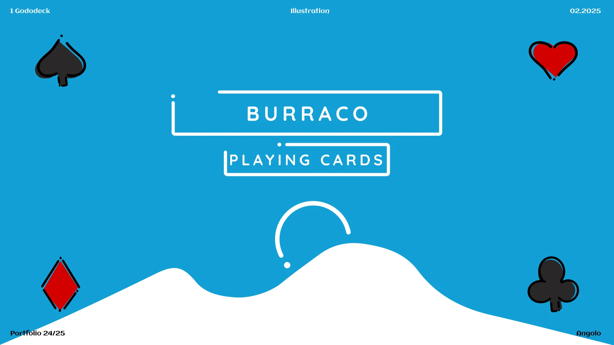
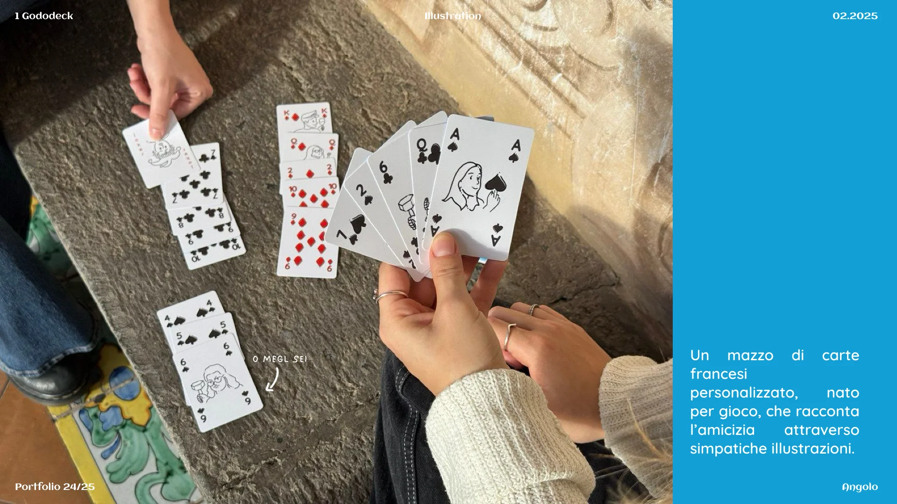
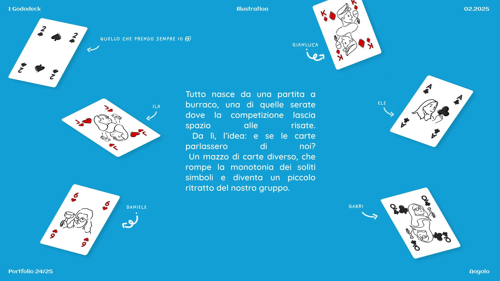
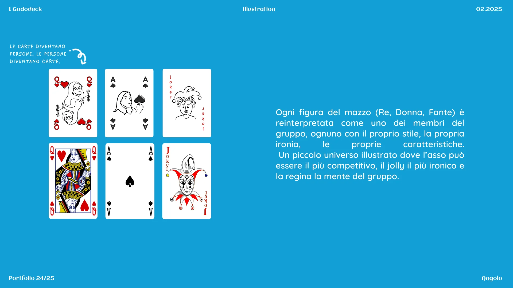
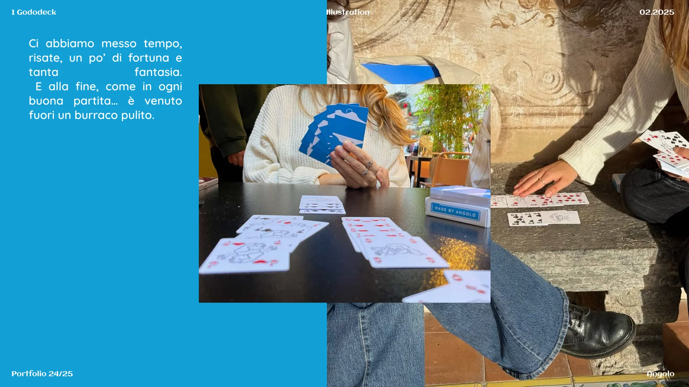

Tutto nasce da una partita a burraco, una di quelle serate dove la competizione lascia spazio alle risate. Da lì, l’idea: e se le carte parlassero di noi?

Un mazzo di carte diverso, che rompe la monotonia dei soliti simboli e diventa un piccolo ritratto del nostro gruppo.

## Le carte diventano persone

Le persone diventano carte. Ogni figura del mazzo, Re, Donna e Fante, è reinterpretata come uno dei membri del gruppo, ognuno con il proprio stile, la propria ironia, le proprie caratteristiche. Un piccolo universo illustrato dove l’asso può essere il più competitivo, il jolly il più ironico e la regina la mente del gruppo.

## Il mazzo è completo

Perfetto per il burraco, ma soprattutto per ricordare quanto è bello giocare insieme.

Ci abbiamo messo tempo, risate, un po’ di fortuna e tanta fantasia. E alla fine, come in ogni buona partita, è venuto fuori un burraco pulito.

