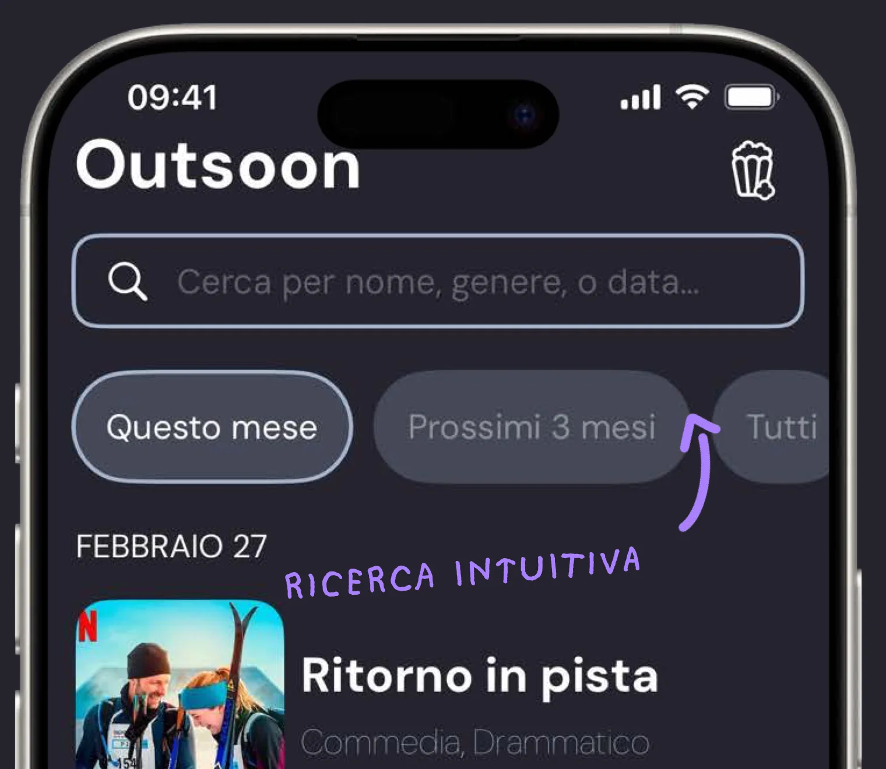
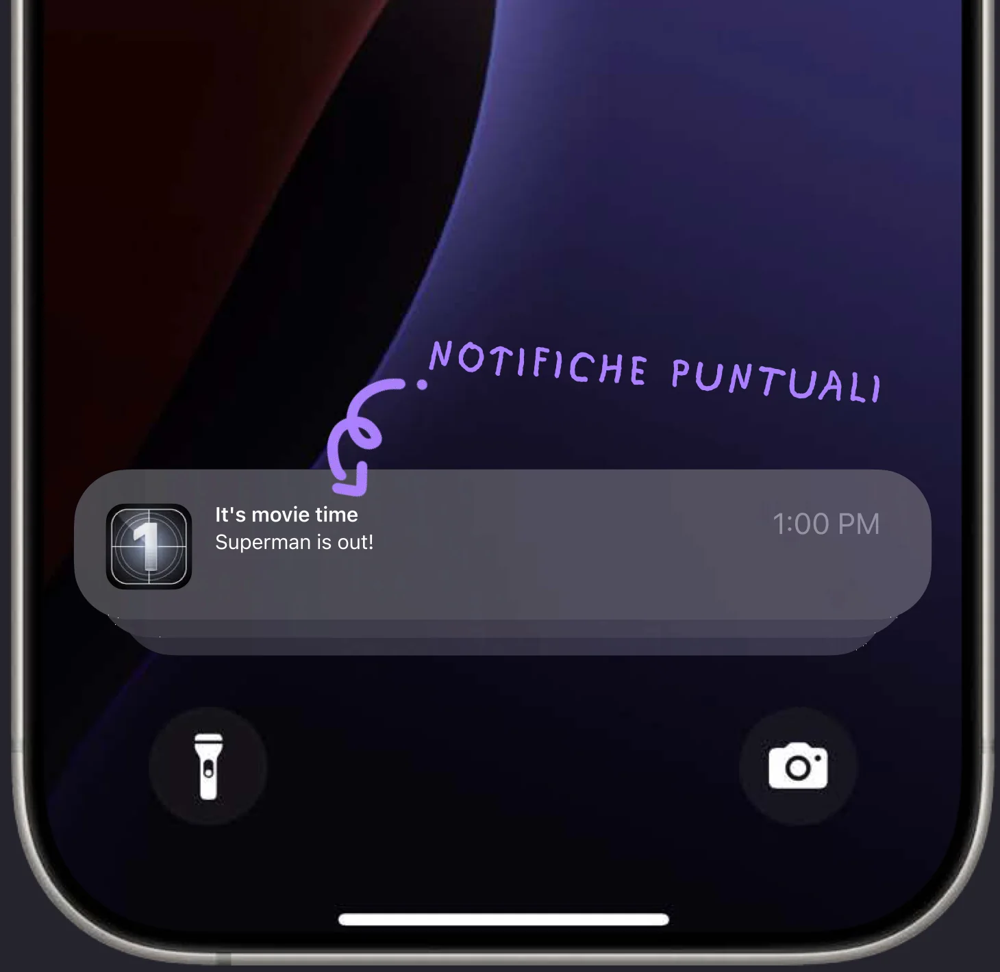
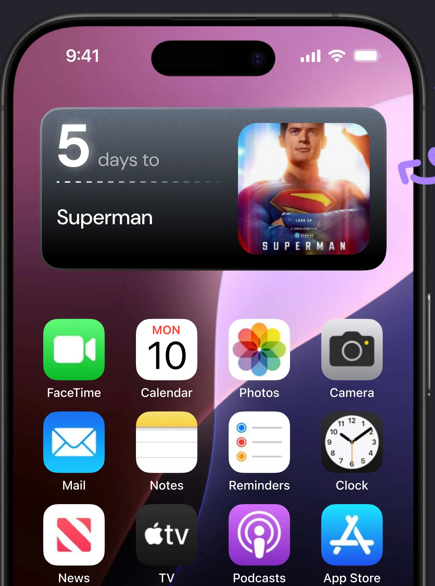
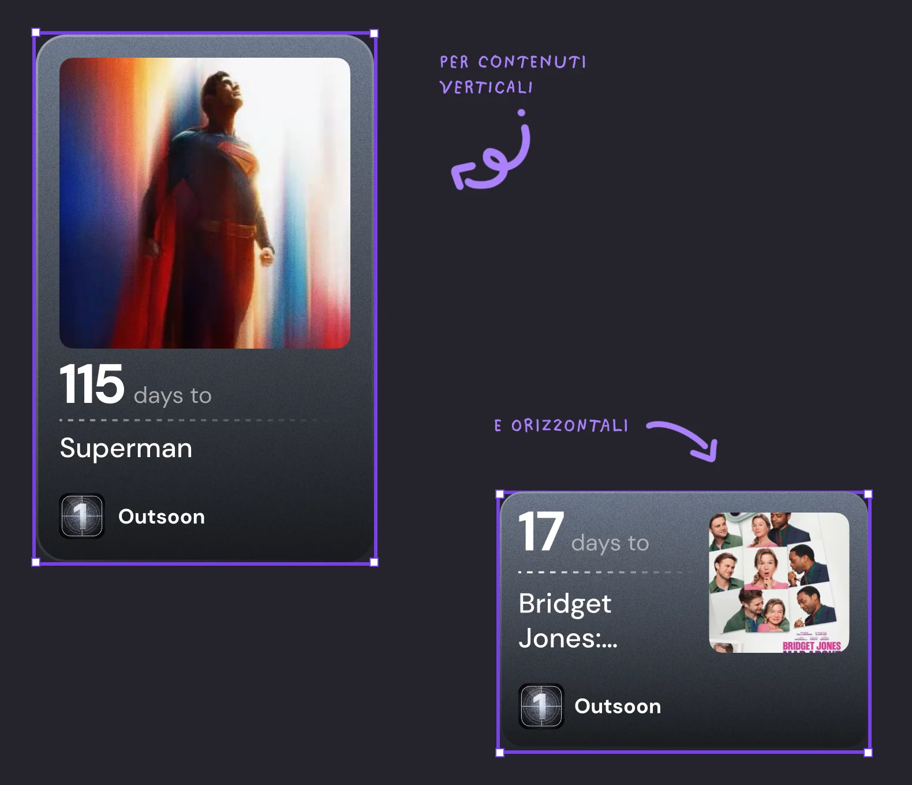
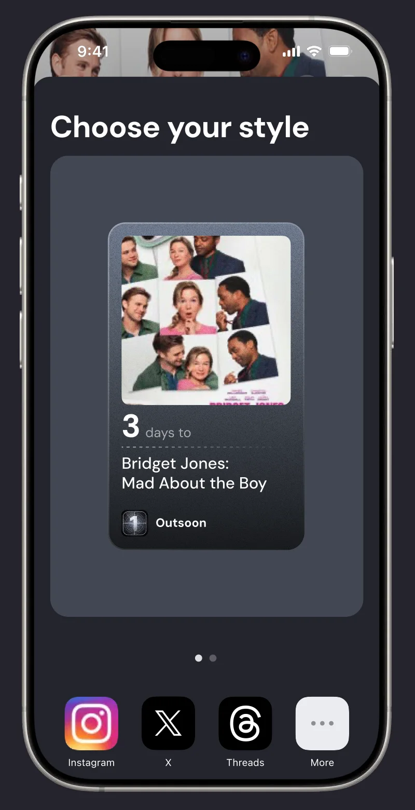
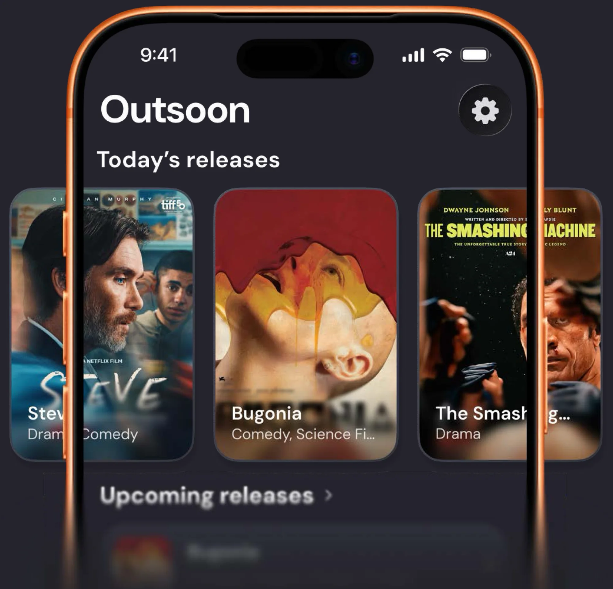

L’idea di Outsoon è nata da una situazione che tutti abbiamo vissuto almeno una volta: scoprire in ritardo l’uscita di un film che volevamo assolutamente vedere.

Tra trailer visti per caso e date di uscita sfuggite tra mille notifiche, ci siamo resi conto che mancava uno spazio semplice, chiaro e centralizzato dove tenere traccia di ciò che stavamo aspettando. Un posto in cui dire: “Ok, fammi sapere solo quando esce, grazie.”

## Cerchi, trovi, aspetti

Una ricerca intuitiva per nome, genere o data. Scegli il film e Outsoon inizia a contare i giorni al posto tuo.

## Notifiche puntuali

Il giorno dell’uscita arriva una notifica: “It’s movie time”. Così, oltre a saperlo, ti ricordi anche di andare al cinema.

## Il countdown sempre sotto gli occhi

Il widget conta i giorni che mancano direttamente sulla schermata Home. Per contenuti verticali o orizzontali: lo stile lo scegli tu.

## Da un’idea fino all’ultima aggiunta

L’ultima arrivata è la feature per condividere il countdown con gli amici, su Instagram, X e Threads. Perché al cinema da soli è più triste.

## E adesso?

Il design è un processo continuo: stiamo già lavorando alla prossima versione di Outsoon, con nuove funzionalità e un’interfaccia aggiornata per la rivoluzione visiva di iOS 26. Fino ad allora, la versione attuale si può scaricare dall’App Store.

