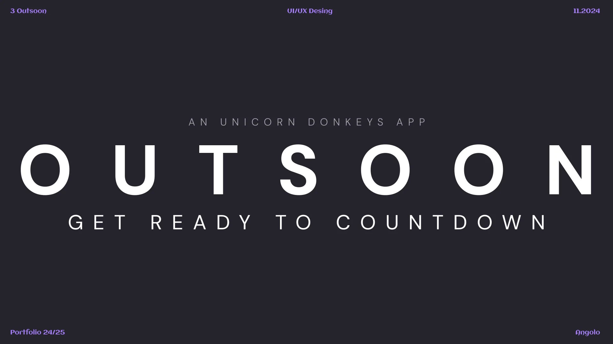
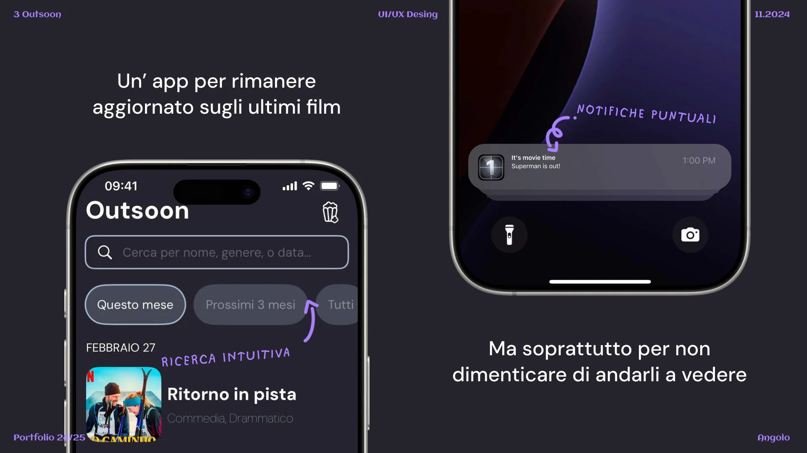
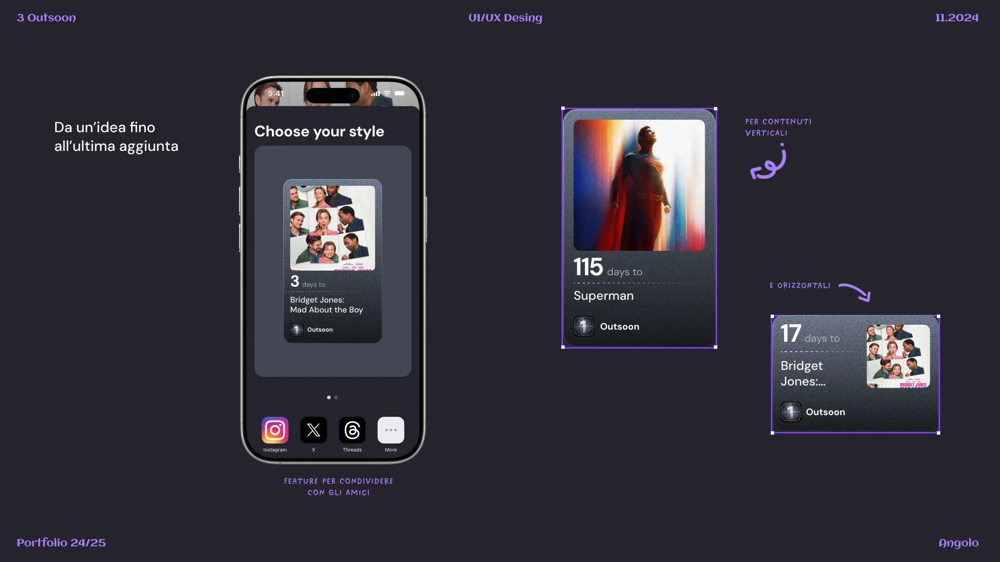
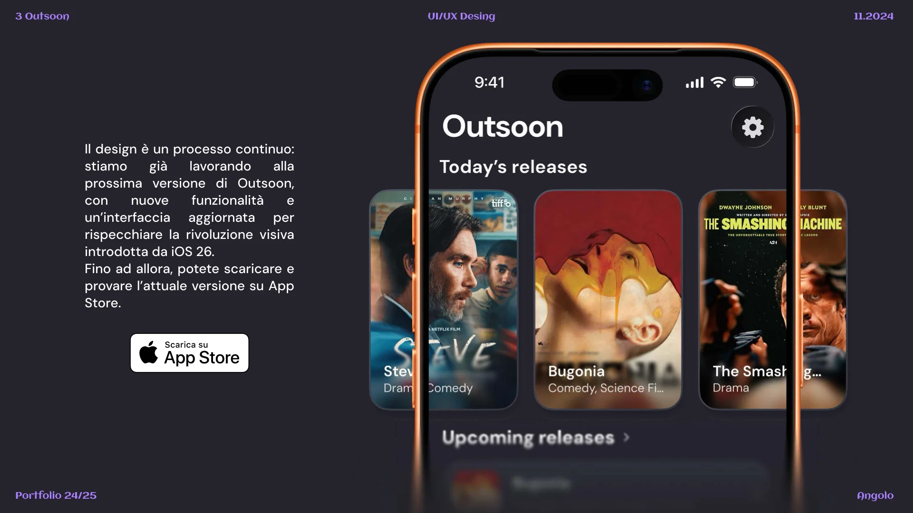

L’idea di Outsoon è nata da una situazione che tutti abbiamo vissuto almeno una volta: scoprire in ritardo l’uscita di un film che volevamo assolutamente vedere.

Tra trailer visti per caso e date di uscita sfuggite tra mille notifiche, ci siamo resi conto che mancava uno spazio semplice, chiaro e centralizzato dove tenere traccia di ciò che stavamo aspettando. Un posto in cui dire: “Ok, fammi sapere solo quando esce, grazie.”

## Ricerca e notifiche

Una ricerca intuitiva per nome, genere o data, e notifiche puntuali il giorno dell’uscita.

## Il countdown

Il widget conta i giorni che mancano, direttamente sulla schermata Home.

## Da un’idea fino all’ultima aggiunta

Widget verticali e orizzontali, e una feature per condividere il countdown con gli amici su Instagram e Threads.

## E adesso?

Il design è un processo continuo: stiamo già lavorando alla prossima versione di Outsoon, con nuove funzionalità e un’interfaccia aggiornata per la rivoluzione visiva di iOS 26. Fino ad allora, la versione attuale si può scaricare dall’App Store.

