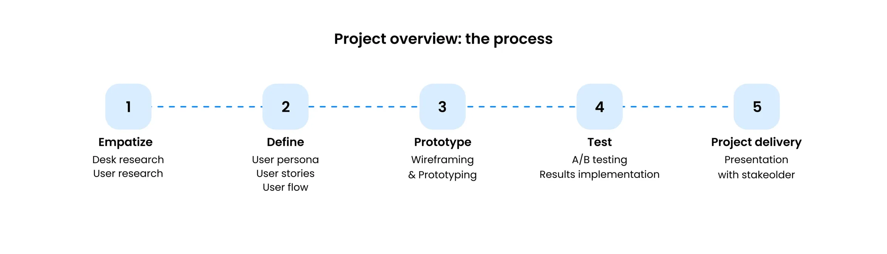
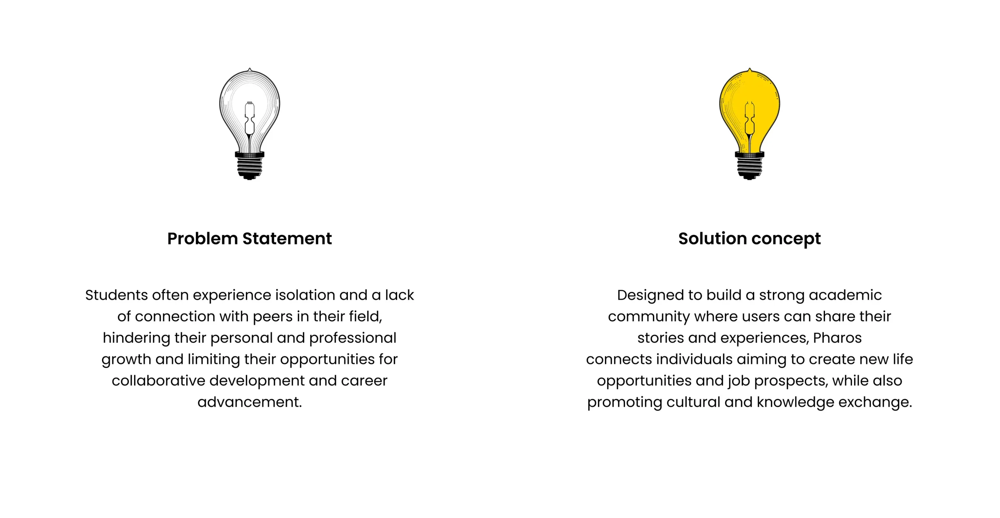
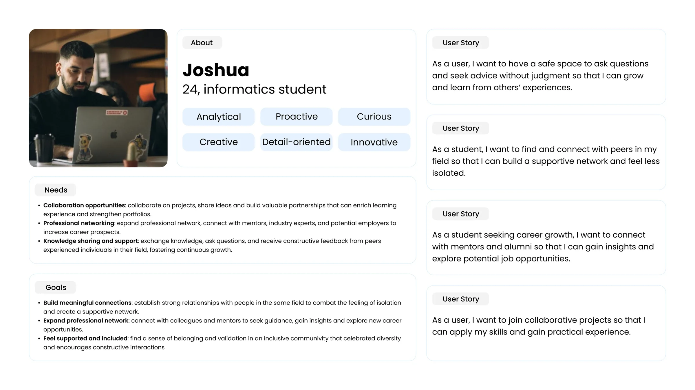
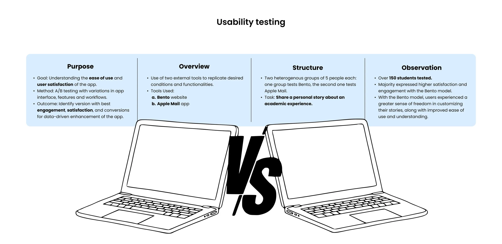
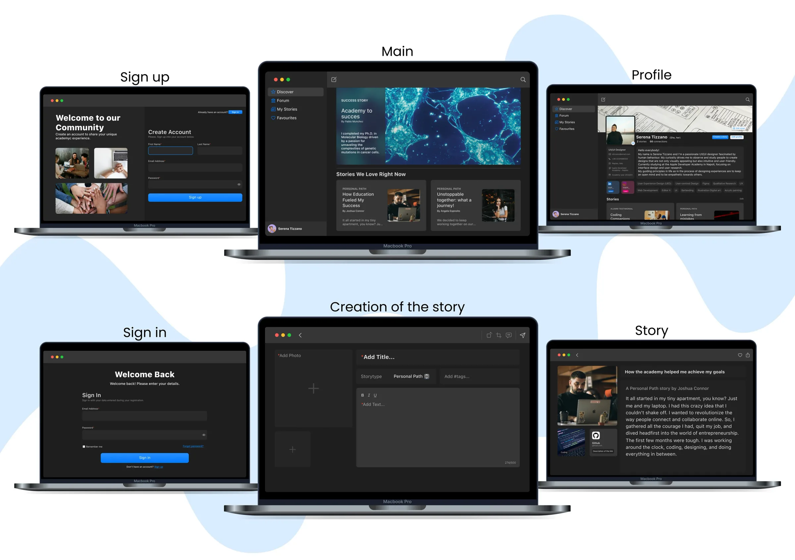
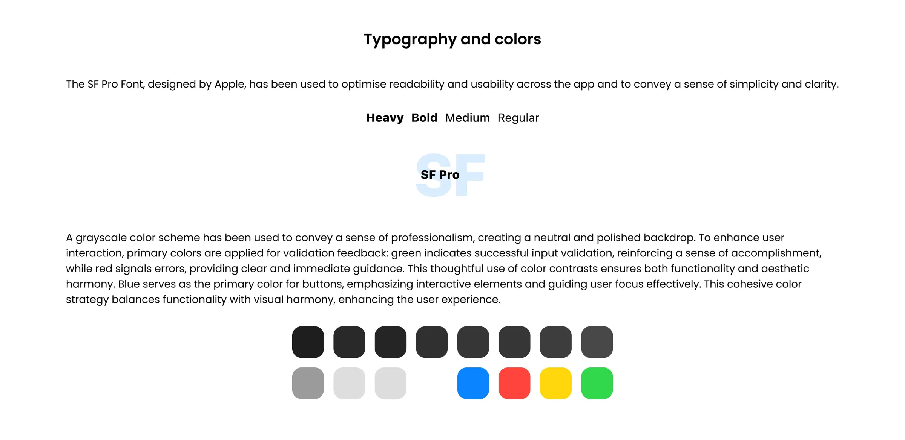

Students often feel isolated and short of connections in their field, which holds back their growth and their chances to work with others. Pharos is a macOS app built for that gap: a place where students share stories and experiences, and find peers, job prospects and new opportunities.

We worked through five stages: empathise, define, prototype, test and deliver.

## Problem and concept

The problem statement and the answer to it, side by side.

## Who it is for

The work started from a persona, Joshua, a 24-year-old informatics student, and from the user stories behind what he needs: a safe space to ask questions, peers in his field, mentors and alumni, and real projects to join.

## Testing

An A/B usability test with two groups of five people, comparing the experience against two existing tools before settling on the final structure.

## The screens

Sign up, sign in, the main feed, the profile, writing a story and reading one.

## Type and colour

SF Pro for readability, a greyscale base for a calm, professional backdrop, and primary colours kept for feedback: green for success, red for errors, blue for actions.

