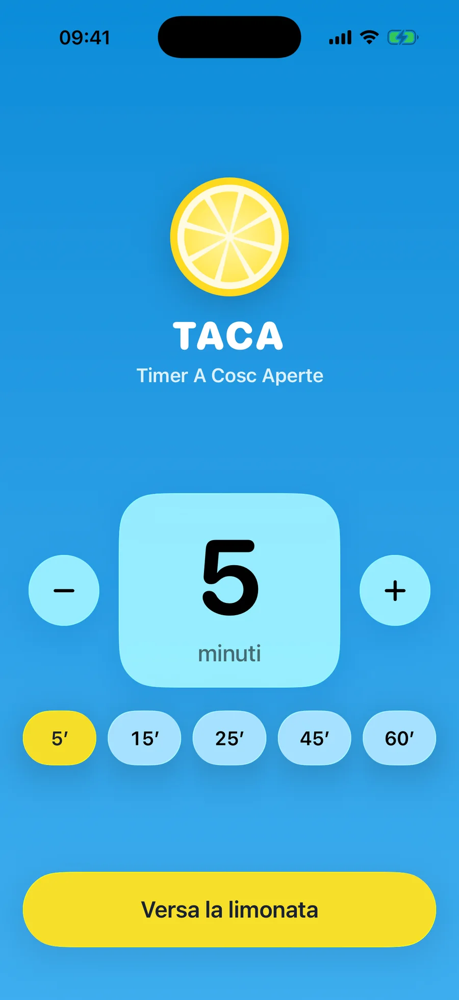
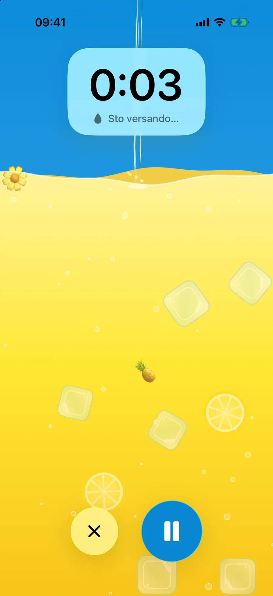
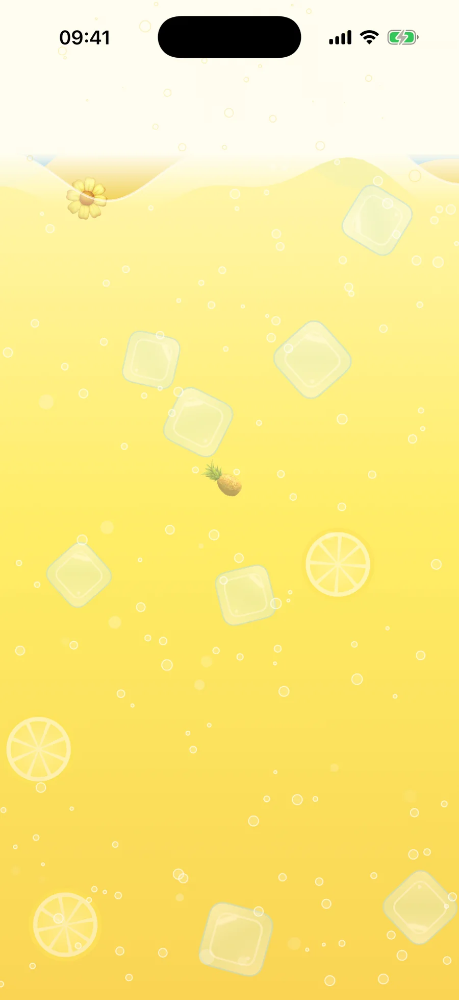
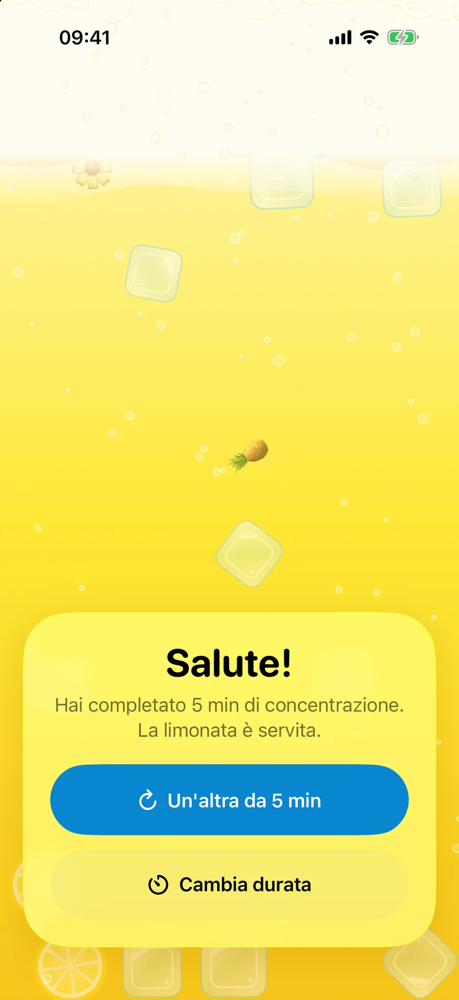

A Napoli d’estate c’è la limonata a cosce aperte: limone, acqua e un cucchiaino di bicarbonato che la fa schiumare di colpo, tanto che per berla ti devi allargare. TACA prende quel rito e lo trasforma in un timer Pomodoro.

Lo schermo è un bicchiere che si riempie di limonata mentre passa il tempo. Cubetti di ghiaccio, fette di limone ed emoji estive cadono nel liquido e galleggiano con una fisica reale. Allo scadere arriva il bicarbonato e la limonata esplode in una montagna di schiuma.

## Il tempo scandito dal ghiaccio

Circa un cubetto al minuto, a volte accompagnato da una fetta di limone o da un’emoji estiva. Gli oggetti si urtano, ruotano e galleggiano in modo diverso: alcuni restano a galla, altri si fermano a metà, altri si posano sul fondo. La superficie resta orizzontale quando inclini il telefono.

## Fatto con Claude Code

TACA l’ho progettata e costruita insieme a Claude Code: SwiftUI per l’interfaccia, SpriteKit per la fisica, una Live Activity per la schermata di blocco e la Dynamic Island, e una notifica a fine sessione. Il design segue le Human Interface Guidelines e Liquid Glass, con VoiceOver, testo dinamico, modalità scura e “Riduci movimento”.
