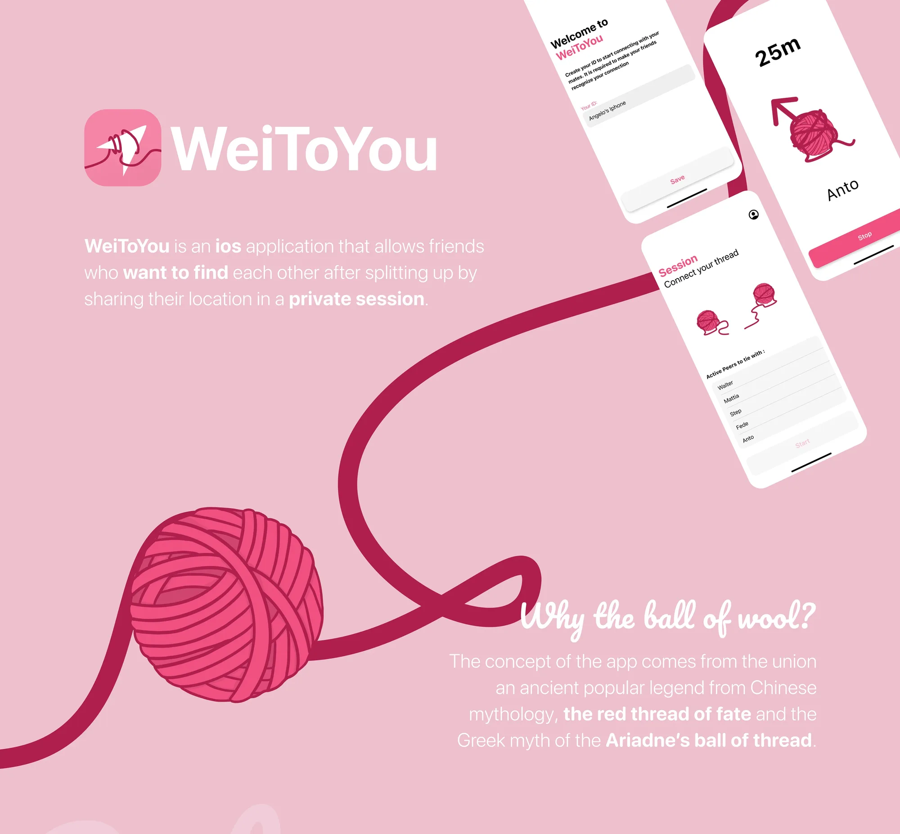
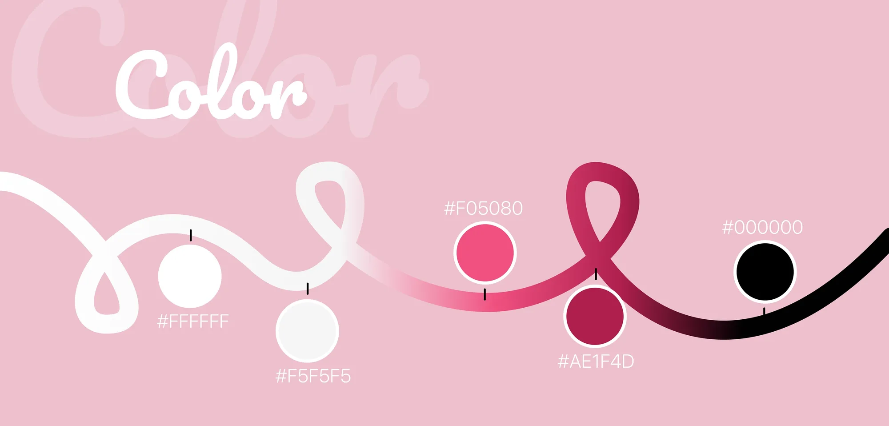
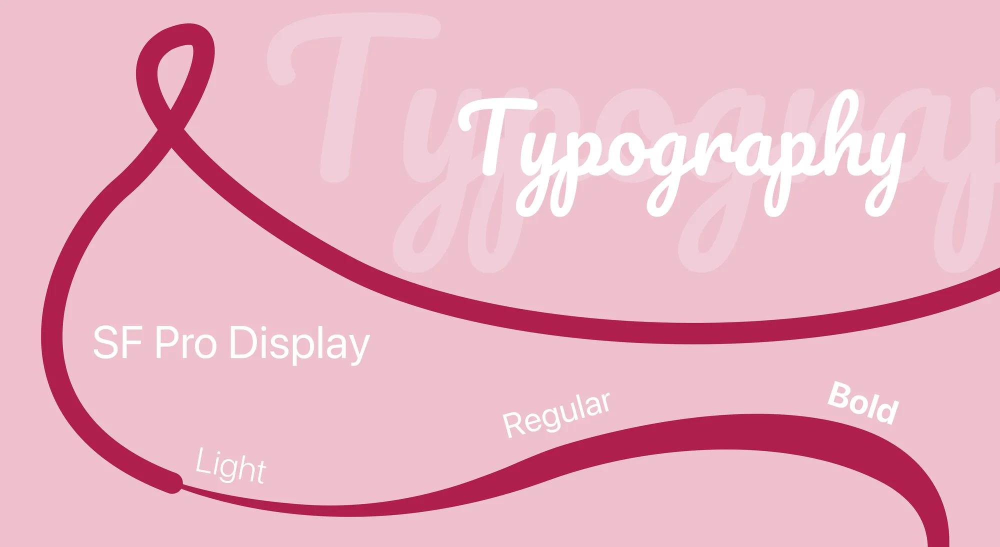
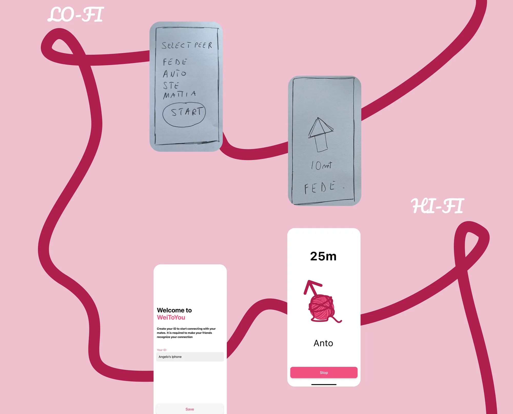

WeiToYou è un’app iOS per gli amici che si perdono dopo essersi separati: aprono una sessione privata, condividono la posizione e seguono il filo per ritrovarsi.

## Perché un gomitolo

L’idea unisce due storie antiche: il filo rosso del destino della leggenda cinese e il filo che Arianna diede a Teseo per uscire dal labirinto. Il filo attraversa tutta l’interfaccia, dal logo alla schermata della distanza.

## Colore

Due rosa, un rosso profondo, il nero e due bianchi. Nient’altro.

## Tipografia

SF Pro Display in tre pesi: light, regular e bold.

## Dalla carta ai pixel

Le prime schermate sono nate a mano su carta, poi ricostruite in Figma come interfaccia finale.

